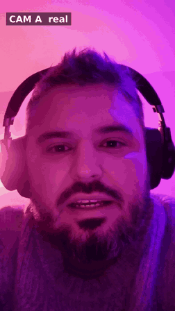
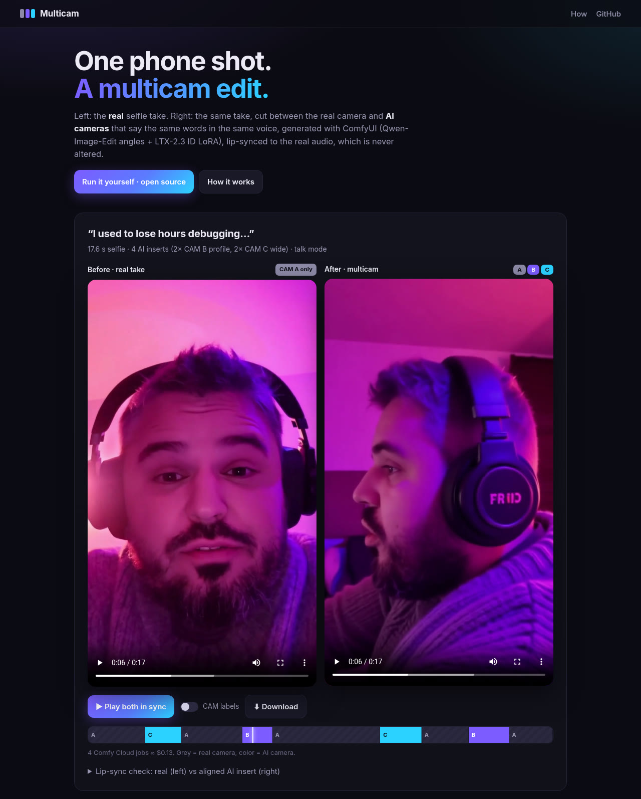
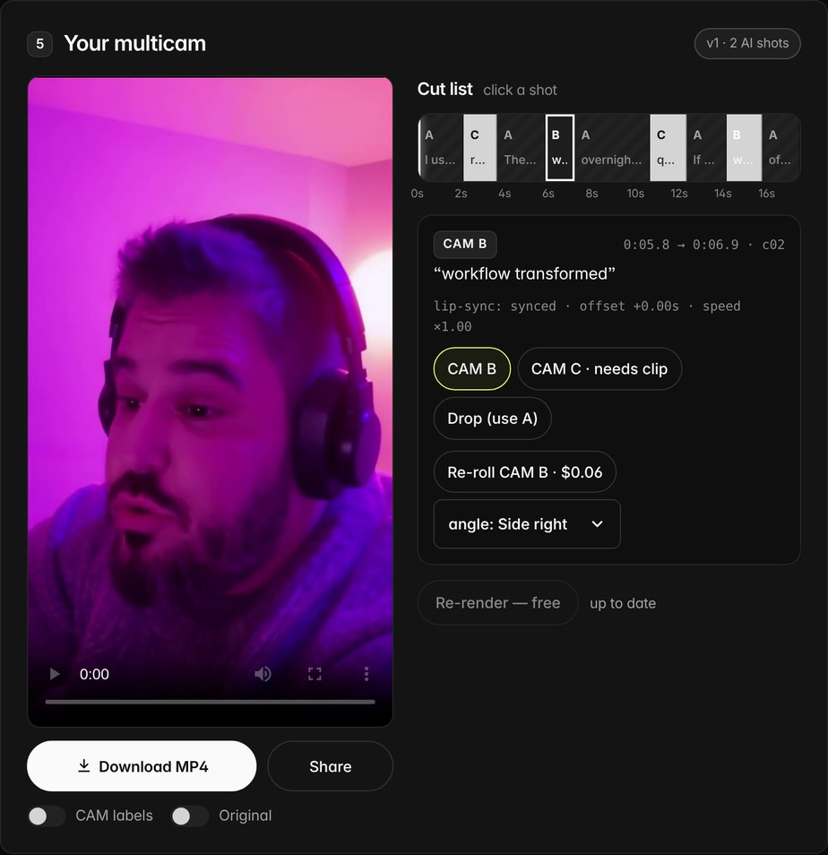
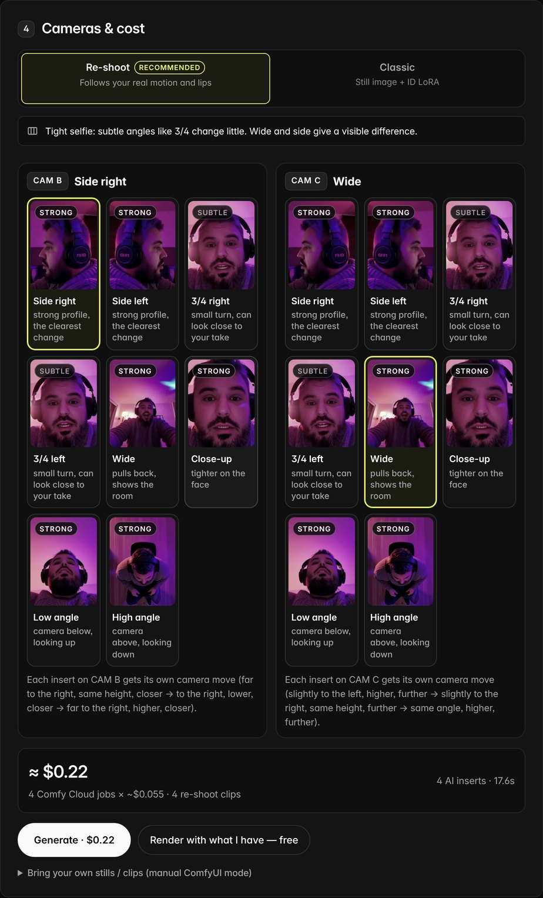
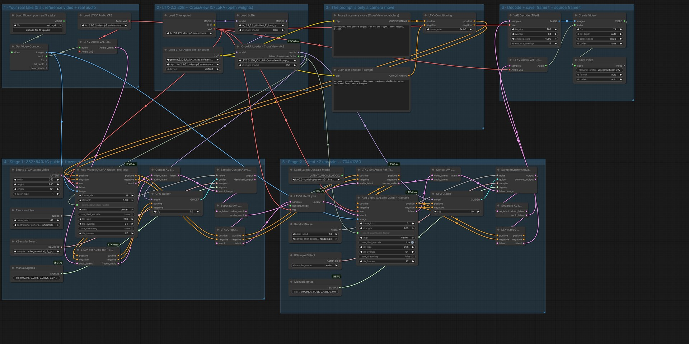
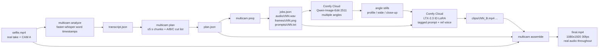
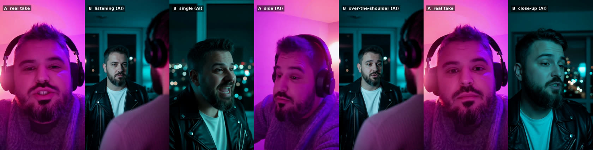

# Multicam from one phone shot

**One selfie take → a multicam edit.** Your real footage is **CAM A**. ComfyUI **re-shoots that
same take from new virtual cameras** (side, 3/4, wide, low…) as **CAM B/C**: same head moves,
same mouth shapes, frame for frame. Then Multicam cuts A/B/C on word boundaries over your
**real, untouched audio**.

A VFX "re-shoot from any angle" app for the Comfy *Open Source Higgsfield* challenge
(#OpenSourceHiggsfield). It's open weights end to end: LTX-2.3 with the CrossView IC-LoRA
(video-to-video re-shoot), plus the classic Qwen-Image-Edit 2511 angles + LTX-2.3 ID LoRA path,
and faster-whisper for the word cuts. MIT licensed.

- **Live gallery (no key needed, before/after):** <https://apsolut.github.io/one-shot-multicam/>
- **Try it:** <https://multicam.apsolut.dev/> (free runs, a few per visitor, while they last; then bring your own Comfy Cloud key, [get one here](https://platform.comfy.org/profile/api-keys); analyze, plan, edit and render are free, a re-shoot insert is ≈ $0.055 on your Comfy credits. Or run it locally in 2 commands, below)
- **Demo video (1:55):** <https://apsolut.github.io/one-shot-multicam/media/submission_demo.mp4> (the app in action, the ComfyUI workflow, Scene and Dub, v0.1 vs v0.2)
- **Release / media:** <https://github.com/apsolut/one-shot-multicam/releases/tag/v0.1.0>

<p align="center"></p>



<table><tr>
<td width="50%"></td>
<td width="50%"></td>
</tr><tr>
<td><sub>Result + cut-list editor: click a shot to switch B/C, drop it, or re-roll just that insert. Re-render is free.</sub></td>
<td><sub>Pick an angle per camera from 8 presets (Re-shoot engine), then confirm the cost estimate before anything is spent.</sub></td>
</tr></table>

## v0.2: the re-shoot engine (default)

The first version animated a Qwen angle **still** with the LTX-2.3 ID LoRA. That kept the face,
but the body was rigid, the motion had nothing to do with the real performance, two wide inserts
reused the same still, and the generated lips had to be retimed onto the real words (0.85–1.15×).

Now each insert is a **video-to-video re-shoot** of the matching 5 s of the real take:

- **LTX-2.3 22B + [CrossView IC-LoRA](https://huggingface.co/Cseti/LTX2.3-22B_IC-LoRA-CrossView-Prompt)**
  (Apache-2.0, on Comfy Cloud). The real segment is the in-context reference video; the prompt is
  only a camera move, e.g. `crossview. new camera angle: far to the right, same height, closer.`
- **The real audio is frozen into the audio latent** (`LTXVSetAudioRefTokens`), so the clip is
  time-locked to the source: generated frame *t* = source frame *t*. Measured on 8 test clips the
  motion lag is 0–1 frames; alignment becomes the identity (offset 0, speed 1), no retime.
- **Identity comes from your real face in every frame**, not from one still, so it holds at
  side and 3/4 angles too.
- **A fresh camera per insert:** each camera preset has several CrossView moves; the n-th insert
  on a camera uses move n, and a re-roll uses the next one. The new background is generated, so
  no two inserts look alike.
- No Qwen still is needed (one job fewer per video). The classic path is still there: toggle
  **Classic** in *Cameras & cost*, or `multicam serve --engine idlora`.

| | v5 (ID LoRA + still) | v6 (CrossView re-shoot) |
|---|---|---|
| Body / head motion | invented, often rigid | your real motion, frame for frame |
| Lip sync | generated lips, retimed 0.85–1.15× | your real mouth shapes (0–1 frame lag) |
| Identity | 9/10 on the best (profile) angle | from the real frames at every angle |
| Two inserts on one camera | same still → look alike | different camera move + background |
| Jobs for a 4-insert video | 1 Qwen + 4 LTX ≈ $0.17 | 4 LTX ≈ $0.22 |

## What you get

| | |
|---|---|
| **Talk mode** (default) | Whisper word timings, inserts that enter mid-phrase and exit on a phrase end, B/C alternation. Re-shoot inserts are time-locked to your real take; classic (ID LoRA) inserts are auto-aligned (offset + 0.85–1.15× retime) to your real words |
| **Music mode** (beta) | Beat-synced inserts placed where your real face is turned away. You supply the lyrics; alignment is by onsets |
| **Scene mode** (new) | **Talk to your other self**: one take becomes a two-person shot / reverse-shot scene. The partner (your restyled other self in your voice, a consented photo, or an AI character) answers with lines you type; see [Scene mode](#scene-mode-talk-to-your-other-self) |
| **Web app** | Upload, transcribe, plan cuts, see a **cost estimate → confirm**, then live per-job progress, player with CAM-label toggle and before/after, download |
| **Remix** | Click any shot on the cut-list timeline: switch B↔C, drop it (back to A), or **re-roll** just that insert (1 job, new seed or another angle). Re-rendering is free |
| **Share** | A self-contained share bundle (HTML page + mp4 + poster, zip) and a ready X post with #OpenSourceHiggsfield |
| **CLI** | Every step is scriptable: `analyze → plan → prep → comfy submit → align → assemble` |

## Quick start

Needs Python 3.10+ and `ffmpeg` on PATH. No local GPU: generation runs on Comfy Cloud.

> **Let your AI set it up:** hand [`docs/AI_GUIDED_INSTALL.md`](docs/AI_GUIDED_INSTALL.md) to Claude, Cursor or
> another coding agent. It walks through local setup and your own Fly.io deploy, with a check after each step.

```bash
git clone https://github.com/apsolut/one-shot-multicam && cd one-shot-multicam
python3 -m venv .venv && . .venv/bin/activate
pip install -r requirements.txt && pip install -e .
multicam serve                      # → http://127.0.0.1:8787
```

Docker:

```bash
docker build -t multicam .
docker run --rm -p 8787:8787 -v multicam-data:/data multicam   # → http://localhost:8787
```

Then: paste your key (step 1), drop a vertical selfie video (step 2), and click **Analyze, free**.
Check the plan and the estimate, then **Generate**.

### Comfy Cloud key

1. Get a Comfy Cloud plan and create an API key at <https://platform.comfy.org/profile/api-keys>.
2. Paste it in the **Comfy Cloud key** field. It's saved **only in your browser's localStorage**
   and sent per request in an `X-Comfy-Key` header to *your* local Multicam server, which
   forwards it to `cloud.comfy.org`. The server keeps it in memory for the duration of that job
   only. It is never written to disk or project state, never logged, and never returned.
3. Free steps (transcribe, plan, align, render, cut-list edits, share) never need the key.

**Why a local server, and not just a static page?** Comfy Cloud's API does not send CORS
headers. We tested this in Chromium (2026-10-27): `fetch("https://cloud.comfy.org/api/queue")`
from a web page fails with "Failed to fetch", with or without an `X-API-Key` header, and so does
`/api/v2/jobs`. Its `OPTIONS` preflight returns 404 (v1) or 401 (v2). A browser therefore can't
call Comfy Cloud directly. The ~150 MB of video and whisper also need a machine, so Multicam
runs a small FastAPI server on localhost. The server sends no CORS headers of its own, so other
websites can't drive your local instance with your key.

**Hosted demo mode (public URL, operator's key, hard cap):**

```bash
export COMFY_API_KEY=...        # the operator's key: a server-side secret, never sent to browsers
multicam serve --host 0.0.0.0 --public --hosted-key-env COMFY_API_KEY --max-jobs 15 --proxy-hops 1
```

The live demo runs on Fly.io from the repo's `fly.toml` (Dockerfile build, 1 GB volume at `/data`):
`fly deploy --remote-only --ha=false`. It is **bring-your-own-key**: every visitor pastes their own
Comfy Cloud key (kept in their browser, forwarded per request, never stored or logged).

**Access modes for the operator's key** (`--hosted-access` / `MULTICAM_HOSTED_ACCESS`):
- `open`: visitors who paste no key use the operator's credits, capped by the guards below.
- `judge` (the live demo): the operator key is used **only** with a private access code
  (secret `MULTICAM_JUDGE_CODE`, sent as `X-Judge-Code`; the UI has a small "Have a promo code?" field),
  capped at `MULTICAM_JUDGE_MAX_JOBS` jobs total (default 10) and still under the balance floor.
  Everyone else must bring their own key. Without a configured code, nobody can use the operator key.
  Set it with `fly secrets set MULTICAM_JUDGE_CODE=... COMFY_API_KEY=...`; never commit it.

**Free trial runs** (`--hosted-runs` / `MULTICAM_HOSTED_RUNS`, on in the live demo with 30): visitors with
no key and no promo code may use the operator key for up to `MULTICAM_TRIAL_RUNS_PER_VISITOR` free runs each
(`--trial-runs-per-visitor`, default 1; the live demo allows 4). A run is one project in any
mode (Talk, Music, Scene or Dub; clips ≤ 30 s), capped at `MULTICAM_TRIAL_JOBS_PER_RUN` Comfy jobs (default
10, so a 17 s Dub of 9 jobs fits). Its paid steps (for example Dub's translate, then generate, or a
re-roll) share that one run. The per-visitor limit counts a visitor's distinct runs (projects) by a salted IP
hash **and** a random first-party cookie (`mc_vid`). The UI shows "X of 30 free runs left" plus how many are left
for you, and falls back to your own key or a promo code
when they're gone. The promo-code (judge) quota is separate and unaffected, and the balance floor stays a hard stop
for both. The counter lives in `<data>/hosted_jobs.json` → `"trial": {"used": N, ...}` (on Fly:
`/data/hosted_jobs.json` on the `multicam_data` volume). Runs that never reached Comfy are refunded, so a
failed upload doesn't burn a visitor's run. **To top up**, raise `MULTICAM_HOSTED_RUNS` in
`fly.toml` (the used count stays) and lower `MULTICAM_HOSTED_FLOOR_USD` by about $0.50 per extra run, then `fly deploy`.

`--public` turns on the public-site guards (no project listing, upload limits, TTL, fast 720p
renders; each can also be set by env var, so a container only needs env):

| Guard | Flag / env | `--public` default |
|---|---|---|
| Global job cap, persisted in `<data>/hosted_jobs.json` (reserved atomically before submit, refunded if the job never reached Comfy) | `--max-jobs` / `MULTICAM_MAX_JOBS` | 15 in `open` mode (≈ $0.80 of re-shoot jobs); the live demo uses 0 |
| Paid jobs per visitor IP per 24 h (IPs stored only as salted hashes) | `--ip-jobs-per-day` / `MULTICAM_IP_JOBS_PER_DAY` | 6 |
| Uploads per visitor IP per hour | `--ip-projects-per-hour` / `MULTICAM_IP_PROJECTS_PER_HOUR` | 4 |
| Max video length / size (checked while streaming and with ffprobe) | `--max-upload-s`, `--max-upload-mb` | 30 s / 60 MB |
| Projects auto-deleted after | `--ttl-minutes` / `MULTICAM_TTL_MINUTES` | 60 min |
| Restart-proof stop: refuse when the key's **real** Comfy balance would fall below a floor (set it to `balance − $1` at deploy) | `--hosted-floor-usd` / `MULTICAM_HOSTED_FLOOR_USD` | off |
| Jobs per click | `--max-jobs-per-run` | 6 |
| Behind a reverse proxy: which `X-Forwarded-For` hop to trust | `--proxy-hops` / `MULTICAM_PROXY_HOPS` | 0 |

The other `MULTICAM_*` env vars are `MULTICAM_HOSTED_KEY_ENV`, `MULTICAM_PUBLIC=1`,
`MULTICAM_DATA_DIR`, `MULTICAM_REPO_URL`, `MULTICAM_ENGINE` (`reshoot` | `idlora`) and `PORT`. In hosted mode the UI shows a banner
with the remaining budget (when it hits zero the banner, the key card and the Generate button all
switch to "paste your own Comfy key"), the project list is disabled, project ids are 64-bit random, and
every upload (in any mode) requires the *"this is my face or I have permission"* checkbox.

## Costs (measured on Comfy Cloud, Oct 2026)

| Job | Workflow | Cost | Time |
|---|---|---|---|
| **1 re-shoot clip** (5.04 s, 704×1280, 24 fps, two-stage) | LTX-2.3 + CrossView IC-LoRA (`workflows/crossview_api.json`) | **~$0.055** | 40–60 s (up to ~2 min when queued) |
| **A 17 s talk video with 4 AI inserts (re-shoot)** | 4 jobs | **≈ $0.22** | ~1–2 min (clips run in parallel) |
| 8 angle stills (classic only) | Qwen-Image-Edit 2511 + Multiple-Angles LoRA | ~$0.03–0.05 | ~1 min |
| 1 camera clip (5 s, 720×1280, 24 fps, classic) | LTX-2.3 ID LoRA | ~$0.033 | 25–50 s |
| A 17 s talk video with 4 AI inserts (classic) | 1 + 4 jobs | ≈ $0.17 | ~2–3 min |
| Re-roll one insert | 1 LTX job | $0.055 / $0.033 | <1 min |
| Dub: translate a take | Gemma 3 12B (`TextGenerate`) | ~$0.01 | 10–20 s |
| Dub: 1 LipDub window (8–10 s) | LTX-2.3 + LipDub IC-LoRA | ~$0.09–0.11 (est.) | 55–90 s |
| **A 17 s take dubbed + multicam** | 1 + 2 LipDub + 4 re-shoots | **≈ $0.42** | ~4–6 min |
| Transcribe, plan, align, render, edit | local CPU | free | ~10–40 s |

Re-shoot cost was measured as the Comfy balance delta over 4 sequential jobs ($0.2198). The app
shows `jobs × per-job cost` and requires a **Confirm** click before it spends anything.

## Workflows, models and licenses

Generation uses two official Comfy Cloud templates, exported in API format to `workflows/`. A
`*_bindings.json` file next to each one maps our inputs to node ids:

| Template (Comfy Cloud) | File | Models | License |
|---|---|---|---|
| **Qwen 1 Click Multiple Character Angles** | `workflows/qwen_angles_api.json` (+ `_ui.json` to open in ComfyUI) | [Qwen-Image-Edit-2511](https://huggingface.co/Qwen/Qwen-Image-Edit-2511) + [fal Multiple-Angles LoRA](https://huggingface.co/fal/Qwen-Image-Edit-2511-Multiple-Angles-LoRA) | Apache-2.0 / Apache-2.0 |
| **LTX-2.3: ID LoRA** | `workflows/idlora_api.json` (+ `_ui.json`) | [LTX-2.3](https://huggingface.co/Lightricks/LTX-2.3) + [ID-LoRA](https://github.com/ID-LoRA/ID-LoRA) (TalkVid), Gemma 3 text encoder | [LTX-2 Community License](https://github.com/ID-LoRA/ID-LoRA/blob/main/LICENSE) (open weights; free under $10M revenue) / Gemma Terms |
| **CrossView re-shoot** (built from the LTX IC-LoRA example graphs; `workflows/build_v2v.py` regenerates it) | `workflows/crossview_api.json` + `crossview_bindings.json` (+ annotated `crossview_ui.json`) | [LTX-2.3](https://huggingface.co/Lightricks/LTX-2.3) 22B dev fp8 + distilled LoRA (0.6) + [CrossView IC-LoRA v0.9](https://huggingface.co/Cseti/LTX2.3-22B_IC-LoRA-CrossView-Prompt) (1.5), Gemma 3 text encoder, x2 spatial upscaler | LTX-2 Community License / Apache-2.0 / Gemma Terms |
| **Dub: LipDub** (`workflows/build_v2v.py dub` regenerates it) | `workflows/dub_api.json` + `dub_bindings.json` | [LTX-2.3](https://huggingface.co/Lightricks/LTX-2.3) 22B dev fp8 + distilled LoRA (0.5) + [LipDub IC-LoRA 0.9](https://huggingface.co/Lightricks/LTX-2.3-22b-IC-LoRA-LipDub) (1.0), Gemma 3 text encoder, x2 spatial upscaler | LTX-2 Community License / Gemma Terms |
| **Dub: translation** | built in `multicam/dub.py` (core `TextGenerate` node), exported as `workflows/translate_api.json` + `translate_bindings.json` | [Gemma 3 12B it](https://huggingface.co/google/gemma-3-12b-it) (bf16) | Gemma Terms |
| (local) speech timings | — | [faster-whisper](https://github.com/SYSTRAN/faster-whisper) `small` | MIT |

There are no partner or closed API nodes; every model is open weights. **[workflows/README.md](workflows/README.md)** lists every
workflow the app runs, the exact model and LoRA files with download links, which node inputs the app sets, and
how to run each one yourself in local ComfyUI or on Comfy Cloud. LTX-2.3 is the core
video model, and Qwen only makes the stills.



Drag `workflows/*_ui.json` into ComfyUI to view and edit the exact graphs (every workflow has one; `*_api.json` is what the app submits). If you run them by hand
in the ComfyUI app, use **Cameras & cost → Bring your own stills / clips** in the web app to
import the results and render for free. Re-shoot clips (from `crossview_ui.json` or `multicam reshoot`)
are time-locked to the source: import them with `synced=true` (API `POST …/clips`) to skip re-alignment.

## Web app architecture

```
browser (multicam/web: vanilla JS, no build)      localhost: multicam serve (FastAPI)          cloud.comfy.org
 key in localStorage ── X-Comfy-Key per request ─▶ /api/projects/...  ── X-API-Key ──────────▶ /api/upload/image
 upload / timeline / share                         thread per action:                          /api/prompt
 polls GET /api/projects/{id}                       whisper → plan → prep                      /api/job/{id}/status
                                                    Qwen angles → LTX jobs (3 in parallel)     /api/jobs/{id}, /api/view
                                                    align → ffmpeg render (labeled + clean)
                                                    ~/.multicam/projects/<id>/ (state.json has no secrets)
```

Main endpoints are `POST /api/projects` (upload + mode + optional script/lyrics; it auto-runs
analyze), `GET /api/projects/{id}`, `POST …/generate {confirm}`, `POST …/angles {confirm}`,
`POST …/reroll {shot, cam, still, confirm}`, `PATCH …/shots {edits}`, `POST …/render`,
`POST …/share`, and `POST …/stills|clips` (import). The OpenAPI docs are at `/api/docs`.

## Gallery (GitHub Pages)

`docs/` is a static, no-key gallery: a before/after player (real take vs multicam) with a
CAM-label toggle, the cut timeline, and the lip-sync check. Enable **Settings → Pages →
Deploy from branch → `main` / `docs`**. `multicam serve` also serves it at `/gallery/`.

The gallery plays small 720p web copies committed in `docs/media/` (about 12 MB total: v0.2 re-shoot, v0.1, and a v0.1-vs-v0.2 side-by-side). Pages
serves them as `video/mp4`, so they play inline everywhere. The same files are attached to the
[v0.1.0 release](https://github.com/apsolut/one-shot-multicam/releases/tag/v0.1.0), and the
Download button uses those links. Release asset URLs come back as `application/octet-stream` +
`attachment`: Chrome plays them inline, but Safari/iOS may not, so they aren't used for
playback. Full-resolution masters are never committed. To add your own example, append an item
to `docs/config.js`.

## How it works (pipeline)



1. **analyze**: transcribes with word-level timestamps (faster-whisper, CPU, int8). If you pass
   the known script (`--script`), it is aligned onto the recognized timings, so `[SPEECH]` gets
   the exact words.
2. **plan**: packs sentences and phrases into generation chunks of up to 5 s (LTX clip length,
   with 0.5 s pre-roll). It then picks cut points with this editorial rule:
   - Start on A and end on A (at least 1 s each).
   - Each chunk gets at most one B/C insert of 1–2 s. Cuts land on word boundaries (inside the
     pause when there is one). Inserts prefer to **enter mid-phrase** and **exit on a phrase
     boundary**.
   - The first 0.5 s of every generated chunk is never used, because the breath at clip start
     doesn't match.
   - Inserts are at least 1.5 s of A apart, so they never come back to back.
   - Inserts alternate between B and C. `--pin c04=B` or `--pin @14.5=B` forces an angle.
3. **prep**: for every chunk that needs generation, exports the audio slice (WAV), the first
   frame at the chunk start (PNG, the input for Qwen angles), the ID LoRA prompt, and a
   `jobs.json` manifest.
4. **align** (runs automatically in `assemble`; turn it off with `--no-align`): a generated clip
   speaks the chunk's words at its own pace, so mapping `clip_time = source_time - chunk_start`
   puts the wrong mouth shapes on screen.
   - It transcribes each clip's own audio with word timestamps and matches the insert's words
     to the real words.
   - It picks the clip in-point so the generated start of the first word lands on the real one.
   - If the generated span (first word start to last word end) is more than 8% longer or
     shorter than the real span, it retimes the **video only** (`setpts`, clamped to
     0.85–1.15x) so both ends line up.
   - It writes `offset`, `speed` and an `align` report into each insert in `plan.json`, and the
     clip words into `clips_aligned.json`.
   - If the clip doesn't contain the insert's words, that insert falls back to A. If the
     aligned window would run past the clip, the cut moves to a nearby word boundary.
   - `multicam sync-check` renders real A on the left and the aligned insert on the right, for
     each insert plus 0.5 s padding, over the real audio.
5. **assemble**: renders 1080x1920 at 30 fps. The original audio stream is copied bit-exact.
   Inserts are scaled and cropped to fill, with optional synthetic handheld shake (`--shake`),
   optional burned-in `CAM A/B/C` labels (`--labels`), and optional audio-safe hard cuts
   (`--cut-lead-frames N`: video cuts N frames before the word, audio untouched). Any shot
   without a generated clip falls back to A. Each shot has an `offset` (seconds) in `plan.json`
   for nudging sync.

Prompt format (one per chunk, `prompts/cNN.txt`):

```
[VISUAL]: Side profile camera angle of the same man, same outfit, same room and lighting, ...
[SPEECH]: If you're still coding the old way, you're leaving a lot of productivity behind.
[SOUNDS]: Energetic male voice, close to the microphone, quiet room, no music.
```

## CLI usage

Re-shoot (default engine):

```bash
export COMFY_API_KEY=...            # never commit this
multicam -C work analyze selfie.mp4 --script "I used to lose hours ..."
multicam -C work plan --pin @14.5=B
multicam -C work reshoot --video selfie.mp4 --dry-run          # prints one camera move per insert
multicam -C work reshoot --video selfie.mp4 --cam B=right90 --cam C=wide   # 1 job per insert
multicam -C work reshoot --video selfie.mp4 --only c04 --variant-shift 1   # re-roll one insert, next move
multicam -C work assemble --clips work/gen/reshoot/clips.json --video selfie.mp4 --shake --out final.mp4
```

Presets: `right90` (side right), `left90`, `right45` (3/4), `left45`, `wide`, `closeup`,
`lowangle`, `aerial` (high angle). The clips.json it writes marks every clip `"synced": true`, so
`assemble`/`align` use offset 0 and speed 1.

Classic path:

```bash
multicam -C work analyze selfie.mp4 --model small --script "I used to lose hours ..."
multicam -C work plan                       # -> work/plan.json (add --pin c04=B, --angles B,C,D ...)
multicam -C work prep                       # -> work/gen/{audio,frames,prompts}/, work/gen/jobs.json
# ... generate clips on Comfy Cloud, save as work/gen/clips/<chunk>_<angle>.mp4 ...
multicam -C work align --clips-dir work/gen/clips   # optional: write offsets/speeds into plan.json
multicam -C work sync-check --clips-dir work/gen/clips --out sync_check.mp4
multicam -C work assemble --clips-dir work/gen/clips --out final.mp4 --shake   # auto-aligns
multicam -C work assemble --clips-dir work/gen/clips --out final_labeled.mp4 --shake --labels
```

Or map clips explicitly. `src_start` is the source time of the clip's first frame and defaults
to the chunk start:

```json
{"c04": {"path": "clips/run7_idlora_profile.mp4", "angle": "B", "src_start": 12.0}}
```

```bash
multicam -C work assemble --clips work/clips.json --out final.mp4
```

Demo (expects `selfie.mp4` and `clips/run7_idlora_profile.mp4` under `--root`):

```bash
multicam demo --root . --name demo_v5   # -> demo_v5.mp4, demo_v5_labeled.mp4 (uses run7 + any work/gen/clips)
```

`examples/` contains the transcript, plan, jobs and clip mapping produced by the demo.

## Comfy Cloud steps (manual, in the browser)

For each job in `jobs.json`:

1. **Angle still**: open the template **"Qwen 1 Click Multiple Character Angles"**
   (Qwen-Image-Edit 2511). Load `frames/<chunk>.png` and pick the angle (profile / wide /
   close-up). Save the result as `stills/<chunk>_<angle>.png`.
2. **Animate**: open the template **"LTX-2.3: ID LoRA"**.
   - Image: the angle still.
   - Reference audio: `audio/<chunk>.wav` (the real voice for that window).
   - Prompt: paste `prompts/<chunk>.txt` exactly. Keep the `[VISUAL]/[SPEECH]/[SOUNDS]` tags and
     the exact transcript words in `[SPEECH]`.
   - Settings: **720x1280** (portrait; the model may output 704x1280), **24 fps**, **5 s**
     (121 frames).
3. Download the mp4 to `clips/<chunk>_<angle>.mp4` and run `multicam assemble --clips-dir ...`.

What we've seen work: identity holds best on profile angles, and front angles tend to look
rigid. Keep inserts at 1–2 s and enter them mid-phrase, so small lip-sync drift isn't noticeable.

### API: one command (tested on Comfy Cloud, 2026-10-27)

Comfy Cloud has a documented HTTP API. You need a paid plan, and calls use the same credits as
the web UI. `multicam comfy submit` uses the v1 endpoints:

1. `POST /api/upload/image` uploads the still **and the WAV**. Audio is accepted on this endpoint
   too. The multipart field is still called `image`.
2. `POST /api/prompt` submits the workflow.
3. `GET /api/job/{id}/status` is polled until the job finishes.
4. `GET /api/jobs/{id}` returns the outputs.
5. `GET /api/view` returns a 302 to a signed URL. The redirect is followed without the API key.

Env var: **`COMFY_API_KEY`** (`COMFY_CLOUD_API_KEY` also works). Create it at
<https://platform.comfy.org/profile/api-keys>. The tool never prints it, so keep it out of
files you commit.

```bash
export COMFY_API_KEY=...            # never commit this
multicam -C work analyze selfie.mp4 --script "..." && multicam -C work plan && multicam -C work prep
multicam comfy submit --jobs work/gen/jobs.json \
  --workflow workflows/idlora_api.json --bindings workflows/idlora_bindings.json \
  --image B=cam_profile.png --image C=cam_wide.png \
  --wait --max-submissions 3            # add --only c02 to try one chunk first
multicam -C work assemble --clips-dir work/gen/clips --shake --out final.mp4
```

- `workflows/idlora_api.json` is the "Export (API)" of the **LTX-2.3: ID LoRA** template.
  `workflows/idlora_bindings.json` maps each value to its node:
  - image → `269.image`
  - audio → `276.audio`
  - prompt → `340:319.value`
  - width / height → `340:330` / `340:324` (720 / 1280)
  - fps → `340:323` (24)
  - duration → `340:331` (5.0)
  - seed → `340:286.noise_seed` (random)

  Every other setting keeps the template default.
- `--image ANGLE=still.png` reuses an existing angle still, so Qwen isn't run. Without it the
  tool uses `stills/<chunk>_<angle>.png` if present, otherwise the chunk's first frame.
- `--dry-run` prints the patched node inputs without calling the API. Each submission is logged,
  without the key, to `work/gen/submissions.json`.
- The tool stops at the first failed job, and `--max-submissions` caps spend.

**Cost (measured):** 3 LTX-2.3 ID LoRA jobs (720x1280, 24 fps, 5 s) moved the Comfy Cloud credit
balance from $34.558 to $34.458, about **$0.10 total, roughly $0.03 per 5 s clip**. Each job took
25–50 s wall time (about 20–38 s of execution). Check spend with
`GET /api/billing/usage/timeseries`: `summary.balance.*_cents` is in cents, and `cost_micros` is
millionths of a USD. Billing data comes from invoices, so it can lag.

Docs: <https://docs.comfy.org/development/cloud/overview>,
<https://docs.comfy.org/development/cloud/api-reference>. The v1 API is marked deprecated in
favor of Comfy API v2 (`POST /api/v2/jobs`, `Authorization: Bearer`,
<https://docs.comfy.org/openapi-v2.yaml>). This tool still uses v1, which works today.

## Scene mode: talk to your other self

**One real take becomes a two-person scene.** You talk; a partner answers between your sentences, and
the edit cuts **shot / reverse-shot** like a drama or a podcast. You are speaker **A** (your real take +
CrossView re-shoots of it), the partner is speaker **B**:

| Partner | Look | Voice |
|---|---|---|
| 🪞 **Your other self** (default) | Your own face from a mirrored frame of your side angle, restyled by Qwen-Image-Edit 2511 into a clearly different "version" of you: wardrobe, light and room (`night`, `noir`, `office`, `studio` or free text) | **Your voice**: the LTX-2.3 ID-LoRA voice reference is a 5 s slice of your real take |
| 🖼 **Person from a photo** | Your upload (**only photos of people who consented**; the app makes you tick that) | An open TTS reference voice ([Kokoro-82M](https://huggingface.co/hexgrad/Kokoro-82M), Apache-2.0, 6 samples ship in `multicam/voices/`) |
| ✨ **AI character** | A fictional person made by Qwen-Image-Edit from a text description | Kokoro voice |



How it works:

1. **Lines.** You type B's lines and pick which of your sentences each one answers (`1:Wait. Really?`),
   or press *Suggest* (templates; an OpenAI-compatible LLM is used only if `MULTICAM_LLM_URL` +
   `MULTICAM_LLM_KEY` are set). Manual entry is the default.
2. **Partner stills, 1 Qwen job.** `workflows/scene_edit_api.json` is the Qwen "Multiple Character
   Angles" template with all 8 branch prompts (and inputs) exposed, so one job returns 8 free-form edits:
   B **single**, B **over-the-shoulder** (your shoulder in the right foreground) and B **close-up**, plus
   alternates. Every B framing looks **screen-right**; your side angle looks screen-left (180° rule;
   the clone frame is mirrored for that).
3. **B's lines, 1 LTX-2.3 ID LoRA job each** (~$0.03): first frame = the still, `[SPEECH]:` = the exact
   line, voice reference = your audio (clone) or a Kokoro sample. The model speaks and moves the lips in
   the same pass, so B's lip sync is native; whisper finds the spoken span and trims padding. One more
   job makes a **B listening** clip for reaction cuts.
4. **Your angles.** CrossView re-shoots of your take (`right90` side for the matched eyeline, `wide`),
   time-locked to your real audio. Reuse the ones from a talk-mode run with `--a-clips` (free).
5. **Edit (free, local).** A's turns use your **real audio**; B's turns use the clip audio
   (level-matched, the mix is loudness-normalized to −16 LUFS). A turn after B opens on your side angle,
   long turns get an **L-cut to B listening** while you keep talking, and every speaker gets ≥ 2 angles.
   **Tight timing** (default): pauses longer than 0.55 s between your sentences are cut out under a camera
   change, and every turn gets short pads, so the dialogue keeps moving. `render --skip 2` drops a
   sentence as an editorial cut, `--open-on react` opens on the partner listening over your shoulder,
   `--loose` keeps the natural pauses (API: `POST /api/scene/{id}/lines {"edit": {...}}`).
   Output: `scene.mp4` (720×1280, 30 fps, yuv420p, +faststart) and a labeled copy.

```bash
# talk to your other self (reuse talk-mode re-shoots of the same take as your angles)
multicam -C sc scene init selfie.mp4 --partner clone --look night \
  --a-clips work/gen/reshoot/clips.json \
  --a-look "a bearded man wearing black over-ear headphones and a grey sweater, lit by magenta light" \
  --line "1:You let an AI write your code?" --line "2@ots:Overnight? Come on. Who reviews it?" \
  --line "4@close:Or I'm the one who still knows how it works."
multicam -C sc scene run --yes --labels      # 1 Qwen + 4 LTX jobs ≈ $0.19, then render
# a podcast with someone else: --partner photo --photo host.png --person woman --voice af_heart
# or a fictional one: --partner character --character "a podcast host in her 30s, curly hair"
```

In the web app pick **🎭 Scene** next to Talk / Music, choose the partner, then write the lines in the
Scene card; the estimate (stills + lines + listening clip + your side angles) is confirmed before
anything is spent. API: `POST /api/scene`, `GET /api/scene/{id}`, `POST /api/scene/{id}/lines|suggest|generate|render`.

Measured on the demo (17.5 s take, 3 answers): 1 Qwen stills job ≈ $0.03–0.06, each B line ≈ $0.03,
total ≈ $0.15–0.20 when your angles are reused. With tight timing the scenes are 24.2 s (other self,
opens on the over-the-shoulder hook) and 23.8 s (podcast, one sentence cut), down from 26–28 s.
Write B's lines as one short sentence: ID LoRA tends to leave a ~0.8 s pause after a full stop.

Honest limits (an independent review of v1 gave resemblance 6/10, AI lip sync 5/10, believability 6/10):
the clone is a restyle, so its skin looks smoothed and it reads slightly slimmer and younger; ID LoRA mouths
can be rigid and repetitive, and a partner can drift into looking at the lens at the end of a clip (the
prompts now ask for articulated mouth shapes, natural skin and a held eyeline; the template's CFG is 1,
so a negative prompt has no effect). Re-roll a weak line with a new seed rather than keeping it. Your real take looks into the lens, so its eyeline isn't matched
to B; the side re-shoots are. B's voice clone is the ID-LoRA reference (pitch close to yours,
measured ~120–160 Hz vs 113 Hz), not a dedicated TTS clone.

## Dub mode: the same take in another language

**One take in, the same take in German / Spanish / Croatian out, with your face and your own voice, then cut
as a multicam edit.** Open weights only, all on Comfy Cloud:

1. **Transcribe** (local whisper, free) and split the take into sentence windows of ≤10 s.
2. **Translate** with Gemma 3 12B (the LTX-2.3 text encoder, through ComfyUI's core `TextGenerate` node,
   ≈ $0.01). You review and edit every line: a 12B model still makes the odd mistake (its Croatian was
   poor, its German needed small fixes), and each line should be about as long as the original. The app
   flags a line that is more than 1.3× longer, because LipDub cuts the end of a line that doesn't fit.
3. **Dub CAM A**: LTX-2.3 + Lightricks' [LipDub IC-LoRA](https://huggingface.co/Lightricks/LTX-2.3-22b-IC-LoRA-LipDub)
   re-renders each window of your real take with new lip motion **and new speech generated from the
   translated text**. Your real audio is only the voice reference, so the new speech is in your voice. Head
   moves, framing and identity come from the real frames, and only the mouth changes.
4. **Multicam**: the dubbed take becomes the source of a normal edit. It is transcribed in the target
   language (aligned to your reviewed lines), the cuts are planned, and the CrossView re-shoots give the
   B/C angles. The re-shoots freeze the dubbed audio, so the side angles speak the new language too.

[EN original | DE | ES | HR side by side (17 s)](docs/media/dub_4lang_v2.mp4) ([v1 before the seam and colour fixes](docs/media/dub_4lang.mp4))

**Window seams and colour.** The first ~0.2 s of each LipDub window still carry the real take's mouth pose,
which shows as a small jump on CAM A at the window boundary. The dubbed take crossfades the video over the
previous window's extra rendered frames (LipDub renders 8k+1 frames, so each clip runs a bit past its
window); the audio cuts hard inside the sentence pause. The multicam edit then **puts a camera cut over
every seam**: it stretches the neighbouring B/C insert back to just before the boundary, or cuts in a short
insert from a re-shoot that spans it. Frame-difference spikes at the seam drop from ~3× normal motion to
normal, apart from the deliberate cut. CrossView inserts render cooler and bluer than the real take, so they
are colour-matched to CAM A (per-channel mean/std over the same 5 s, 60 % strength, `--color-match 0.6` in
`assemble`): CAM C's blue channel moved from 165 to 134, against 118 in CAM A. Face structure in the
far/wide angles still drifts. A stronger CrossView IC-LoRA (1.8 vs 1.5) did not help in a test (tighter
framing, no better likeness), so it stays at 1.5.

**Measured on the 17.6 s demo take** (2 windows, 4 inserts): every translated word was spoken. A
whisper transcript of each dub matched the reviewed text apart from ASR slips such as "Cloud Code".
LipDub took 55–92 s per window. German and Spanish sound natural. **Croatian is not one of LipDub's
validated languages** (EN/FR/ES/DE/RU). It works and stays intelligible, but has an audible accent, so
the app labels it experimental. Cost ≈ **$0.41** per 17 s take (≈ $0.19 LipDub + $0.22 re-shoots). The
LipDub figure is estimated from GPU time; a clean balance delta was not possible with other jobs running.
After an edit, only the changed lines are re-dubbed.

```bash
multicam -C work_de dub --video take.mp4 --lang de --translate-only   # 1 cheap job -> work_de/dub_de.json
# fix the lines in work_de/dub_de.json ("translation"), then:
multicam -C work_de dub --video take.mp4 --lang de --multicam          # LipDub + CrossView -> work_de/mc_de/multicam.mp4
```

In the web app, pick **🌍 Dub**, choose the language, upload, then **Translate** → edit → **Dub + multicam**.
Only dub your own face and voice.

## Music mode (dance / lip-sync clips)

For clips with music and no reliable speech. Whisper hallucinates on music, so lyrics come from
you.

```bash
multicam -C work plan --music --video clip.mp4 \
  --lyric "8.0-9.4=first lyric line" --lyric "13.4-14.6=ah ah ah ah" \
  --angle-name B=side --angle-name C=closeup --inserts 3 \
  --visual-extra "short outfit/look description to help identity"
multicam -C work prep          # music prompts; audio slices come from the real track
multicam comfy run --workflow workflows/qwen_angles_api.json --bindings workflows/qwen_angles_bindings.json \
  --set image=frame.png --out-dir angles/                 # optional: 8 angle stills in one job
multicam comfy submit --jobs work/gen/jobs.json --workflow workflows/idlora_api.json \
  --bindings workflows/idlora_bindings.json --image B=angles/side.png --image C=angles/closeup.png --wait
multicam -C work assemble --clips-dir work/gen/clips --shake --out final.mp4
```

- **Beats:** librosa beat tracking. Inserts are 1–2 s and start and end exactly on beats. The
  first and last shots are A.
- **No wides over singing:** same rule as Talk (no wides over speech). A wide camera (`C` = wide
  by default, or any angle named "wide") is only planned over instrumental or silent gaps. Sung
  spans are your lyric lines; with no lyrics every audible stretch counts as sung, so wides only
  land in silence. Inserts over singing go to the other angles, and the render guard swaps a wide
  that ends up over a sung span (a pin or a manual edit) for another angle or CAM A.
- **Covering weak moments:** OpenCV's frontal-face detector scores every frame. Inserts go where
  the real face is turned away or covered (the plan reports `face-hidden %` per insert).
- **Prompts:** `[VISUAL]` is an angle template (same person, same outfit, same place and lighting,
  dancing and lip-syncing, photorealistic) plus `--visual-extra`. `[SPEECH]` holds the
  whole lyric lines inside the 5 s window, or `ah ah ah`. `[SOUNDS]` is
  `loud electronic dance music, energetic`.
- **Align:**
  - If an insert has lyric words and the generated clip sings them, it is word-aligned. With a
    single word it's offset-only.
  - Otherwise the generated clip's onset envelope is cross-correlated with the real track
    (±0.5 s, offset only).
  - Music inserts never fall back to A for missing words.
- **Output size:** assemble defaults to the source's own resolution and fps.
- **Qwen 1-click angles** (`qwen_angles_bindings.json`): one input image (`25.image`) goes in and
  8 stills come out: close-up, wide-angle, ±45°, ±90°, low angle and aerial. Seeds stay at the
  template defaults.
- **Measured cost:** 1 Qwen job (8 stills) plus 3 ID LoRA 5 s clips cost about $0.13 in total.

## Every job ships its ComfyUI workflow

Every finished job in the web app has a **⬇ ComfyUI workflow** link: the exact API-format graph Multicam
submitted to Comfy Cloud for that clip (a per-job link in Talk/Music, and a zip in the result card when there
are several, including Scene and Dub). The same files are saved in the project folder under
`workflows/NN_<kind>_<prompt_id>.json`. Open one in ComfyUI or POST it to `/api/prompt` to re-run or modify that shot.
API: `GET /api/{projects|scene|dub}/<id>/workflows` (list), `…/workflow/<prompt_id>` (one JSON), `…/workflows.zip`.

## Continuity rules (automatic, free)

Found in review (2026-10-28) and now enforced by the planner, the assembler and the Scene editor (`multicam/continuity.py`):

- **No wide over speech.** In a pulled-back CrossView wide, the mouth is 0.28–0.45× the size it is in the real
  take. Lips can't be read at that size, so the shot looks "mouth closed, body frozen" while the voice plays.
  Wides (`wide`, `aerial`) are only used where the person on screen is silent or listening. With the default
  cameras (B = side, C = wide), a talking take therefore gets its inserts on B.
- **Mouth-motion check per insert** (`multicam/lipcheck.py`, OpenCV YuNet face landmarks, CPU, ~0.5 s per insert).
  An insert over speech is dropped if it has no face, a mouth far smaller than the real take's, or articulation
  far below the real take's over the same source span. It is replaced by another speech-safe angle that covers
  the span, otherwise by the real take.
- **One camera = one set.** Every insert on a camera uses the same CrossView camera phrase and seed, so CAM C
  can't jump between two hallucinated rooms. A re-roll still moves that one shot to the next variant.
- **Scene partner mirrors A.** B stills and clips are prompted "seated, same height, same room/lighting as the
  source frame". The posture is read from the source frame (`--posture` overrides it); `--set look` keeps the
  old per-look room.

## Next

- **MCP server, so your own agent can drive Multicam.** A small `multicam mcp` server, using the same FastAPI
  endpoints, would expose tools like `analyze(video)`, `get_plan`, `set_cameras`, `estimate`, `generate`,
  `dub(lang)`, `scene(script)`, `status` and `download(kind="video"|"workflows")`. Claude, Cursor or any
  MCP client could then cut, re-shoot and dub clips from a chat ("make a 3-camera German version of
  this take, under $1"). Your own Comfy key would stay in the server's env. The building blocks (stateless
  HTTP API, cost estimate before every paid step, downloadable workflows) are already in place.
- Per-shot re-roll in the UI. Longer clips with chunked whisper. More languages for Dub.

## Limitations

- Generated clips are 5 s windows. A sentence longer than about 4.5 s gets split at phrase or
  word boundaries.
- Re-shoot: CrossView v0.9 is a proof-of-concept LoRA trained on a ±60° frontal sector, so it
  can't show you from behind. The background is re-imagined each time, and "further" moves can
  invent a desk or a pose for the hidden body (it only sees what the selfie saw). Framing can come
  out off-center on some seeds; re-roll that insert. Output is 704×1280 and upscaled.
- Classic path: lip sync on generated angles is approximate. Auto-align corrects in-point and pace from
  Whisper word timings, which are only accurate to about ±50–100 ms. It assumes the generated
  lips follow the generated audio. Inserts stay short, and you can still nudge `offset` and
  `speed` by hand in `plan.json`.
- The first ~0.5 s of each generated chunk is excluded (breath/onset mismatch).
- Neighboring chunk windows can overlap by up to the 0.5 s pre-roll. Each chunk is generated on
  its own.
- ASR errors show up in `[SPEECH]` unless you pass `--script`. The script is aligned
  difflib-style: mismatched words take the timing of the words they replace.
- Music mode: lyric timings are whatever you pass in. Face visibility uses a simple Haar
  detector. Close-up ID LoRA clips can come out almost static.
- Only one speaker and one take. No face tracking: inserts are center-cropped to fill.
- The Comfy Cloud client has been tested only with the LTX-2.3 ID LoRA export. Other workflows need their own bindings file.
- Classic path: reusing one wide still for several chunks makes those inserts look alike (the re-shoot engine avoids this).
- Qwen's ±45°/±90° side views on a **vertical** frame often come back rolled 90° (tested twice). The
  app defaults to close-up (B) and wide (C); pick other stills in the UI, or bring your own.
- The web app runs one pipeline action per project at a time, and keeps projects on local disk
  (`~/.multicam/projects`). It's a local tool, not a multi-tenant service.
- The Dockerfile hasn't been built in CI yet. The local `pip` path is what was tested.

## Ethics

Only use **your own face, or the face of someone who explicitly agreed** to be animated. The
tool clones a voice and a likeness by design. Don't use it to put words in anyone's mouth: the
generated cameras say *exactly* the words of the real take, and the labeled export marks them
`(AI)`. Keep that label when you post anywhere that could be mistaken for news or testimony.
Don't use copyrighted music in public posts.

## License

Code: MIT © 2026 Aleksandar Perisic. Models keep their own licenses (see above).
