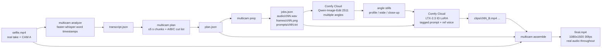

# Multicam from one phone shot

**One selfie take → a multicam edit.** Your real footage is **CAM A**. ComfyUI generates
**CAM B/C** angles of you (close-up, wide, profile…) **saying the same words in your own
voice**, then Multicam cuts A/B/C on word boundaries over your **real, untouched audio**.

A VFX "re-shoot from any angle" app for the Comfy *Open Source Higgsfield* challenge
(#OpenSourceHiggsfield). It's open weights end to end: Qwen-Image-Edit 2511 angles, LTX-2.3 ID
LoRA video, and faster-whisper for sync. MIT licensed.

<!-- TODO: replace with a GIF of the app: docs/assets/demo.gif -->
<!--  -->
<!--  -->

- **Live gallery (no key needed):** <https://apsolut.github.io/one-shot-multicam/> (`docs/`, see
  [Gallery](#gallery-github-pages))
- **Demo video (< 2 min):** TODO link

## What you get

| | |
|---|---|
| **Talk mode** (default) | Whisper word timings, inserts that enter mid-phrase and exit on a phrase end, B/C alternation, and lip-sync auto-align (offset + 0.85–1.15× retime) of every AI shot to your real words |
| **Music mode** (beta) | Beat-synced inserts placed where your real face is turned away. You supply the lyrics; alignment is by onsets |
| **Web app** | Upload, transcribe, plan cuts, see a **cost estimate → confirm**, then live per-job progress, player with CAM-label toggle and before/after, download |
| **Remix** | Click any shot on the cut-list timeline: switch B↔C, drop it (back to A), or **re-roll** just that insert (1 job, new seed or another angle). Re-rendering is free |
| **Share** | A self-contained share bundle (HTML page + mp4 + poster, zip) and a ready X post with #OpenSourceHiggsfield |
| **CLI** | Every step is scriptable: `analyze → plan → prep → comfy submit → align → assemble` |

## Quick start

Needs Python 3.10+ and `ffmpeg` on PATH. No local GPU: generation runs on Comfy Cloud.

```bash
git clone https://github.com/apsolut/one-shot-multicam && cd one-shot-multicam
python3 -m venv .venv && . .venv/bin/activate
pip install -r requirements.txt && pip install -e .
multicam serve                      # → http://127.0.0.1:8787
```

Docker:

```bash
docker build -t multicam .
docker run --rm -p 8787:8787 -v multicam-data:/data multicam   # → http://localhost:8787
```

Then: paste your key (step 1), drop a vertical selfie video (step 2), and click **Analyze, free**.
Check the plan and the estimate, then **Generate**.

### Comfy Cloud key

1. Get a Comfy Cloud plan and create an API key at <https://platform.comfy.org/profile/api-keys>.
2. Paste it in the **Comfy Cloud key** field. It's saved **only in your browser's localStorage**
   and sent per request in an `X-Comfy-Key` header to *your* local Multicam server, which
   forwards it to `cloud.comfy.org`. The server keeps it in memory for the duration of that job
   only. It is never written to disk or project state, never logged, and never returned.
3. Free steps (transcribe, plan, align, render, cut-list edits, share) never need the key.

**Why a local server, and not just a static page?** Comfy Cloud's API does not send CORS
headers. We tested this in Chromium (2026-10-27): `fetch("https://cloud.comfy.org/api/queue")`
from a web page fails with "Failed to fetch", with or without an `X-API-Key` header, and so does
`/api/v2/jobs`. Its `OPTIONS` preflight returns 404 (v1) or 401 (v2). A browser therefore can't
call Comfy Cloud directly. The ~150 MB of video and whisper also need a machine, so Multicam
runs a small FastAPI server on localhost. The server sends no CORS headers of its own, so other
websites can't drive your local instance with your key.

**Hosted demo mode (public URL, operator's key, hard cap):**

```bash
export COMFY_API_KEY=...        # the operator's key: a server-side secret, never sent to browsers
multicam serve --host 0.0.0.0 --public --hosted-key-env COMFY_API_KEY --max-jobs 30 --proxy-hops 1
```

Visitors who paste no key use the operator's credits. `--public` turns on all the guards
(each can also be set by env var, so a container only needs env):

| Guard | Flag / env | `--public` default |
|---|---|---|
| Global job cap, persisted in `<data>/hosted_jobs.json` (reserved atomically before submit, refunded if the job never reached Comfy) | `--max-jobs` / `MULTICAM_MAX_JOBS` | 30 (≈ $1) |
| Paid jobs per visitor IP per 24 h (IPs stored only as salted hashes) | `--ip-jobs-per-day` / `MULTICAM_IP_JOBS_PER_DAY` | 6 |
| Uploads per visitor IP per hour | `--ip-projects-per-hour` / `MULTICAM_IP_PROJECTS_PER_HOUR` | 4 |
| Max video length / size (checked while streaming and with ffprobe) | `--max-upload-s`, `--max-upload-mb` | 30 s / 60 MB |
| Projects auto-deleted after | `--ttl-minutes` / `MULTICAM_TTL_MINUTES` | 60 min |
| Restart-proof stop: refuse when the key's **real** Comfy balance would fall below a floor (set it to `balance − $1` at deploy) | `--hosted-floor-usd` / `MULTICAM_HOSTED_FLOOR_USD` | off |
| Jobs per click | `--max-jobs-per-run` | 6 |
| Behind a reverse proxy: which `X-Forwarded-For` hop to trust | `--proxy-hops` / `MULTICAM_PROXY_HOPS` | 0 |

The other `MULTICAM_*` env vars are `MULTICAM_HOSTED_KEY_ENV`, `MULTICAM_PUBLIC=1`,
`MULTICAM_DATA_DIR`, `MULTICAM_REPO_URL` and `PORT`. In hosted mode the UI shows a banner
with the remaining budget, the project list is disabled, project ids are 64-bit random, and
every upload (in any mode) requires the *"this is my face or I have permission"* checkbox.

## Costs (measured on Comfy Cloud, Oct 2026)

| Job | Workflow | Cost | Time |
|---|---|---|---|
| 8 angle stills | Qwen-Image-Edit 2511 + Multiple-Angles LoRA | ~$0.03–0.05 | ~1 min |
| 1 camera clip (5 s, 720×1280, 24 fps) | LTX-2.3 ID LoRA | ~$0.033 | 25–50 s |
| A 17 s talk video with 4 AI inserts | 1 + 4 jobs | **≈ $0.17** | ~2–3 min (clips run in parallel) |
| Re-roll one insert | 1 LTX job | ~$0.03 | <1 min |
| Transcribe, plan, align, render, edit | local CPU | free | ~10–40 s |

The app shows `jobs × $0.033` and requires a **Confirm** click before it spends anything.

## Workflows, models and licenses

Generation uses two official Comfy Cloud templates, exported in API format to `workflows/`. A
`*_bindings.json` file next to each one maps our inputs to node ids:

| Template (Comfy Cloud) | File | Models | License |
|---|---|---|---|
| **Qwen 1 Click Multiple Character Angles** | `workflows/qwen_angles_api.json` (+ `_ui.json` to open in ComfyUI) | [Qwen-Image-Edit-2511](https://huggingface.co/Qwen/Qwen-Image-Edit-2511) + [fal Multiple-Angles LoRA](https://huggingface.co/fal/Qwen-Image-Edit-2511-Multiple-Angles-LoRA) | Apache-2.0 / Apache-2.0 |
| **LTX-2.3: ID LoRA** | `workflows/idlora_api.json` (+ `_ui.json`) | [LTX-2.3](https://huggingface.co/Lightricks/LTX-2.3) + [ID-LoRA](https://github.com/ID-LoRA/ID-LoRA) (TalkVid), Gemma 3 text encoder | [LTX-2 Community License](https://github.com/ID-LoRA/ID-LoRA/blob/main/LICENSE) (open weights; free under $10M revenue) / Gemma Terms |
| (local) speech timings | — | [faster-whisper](https://github.com/SYSTRAN/faster-whisper) `small` | MIT |

There are no partner or closed API nodes; every model is open weights. LTX-2.3 is the core
video model, and Qwen only makes the stills.

Open `workflows/*_ui.json` in ComfyUI to see or tweak the exact graphs. If you run them by hand
in the ComfyUI app, use **Cameras & cost → Bring your own stills / clips** in the web app to
import the results and render for free.

## Web app architecture

```
browser (multicam/web: vanilla JS, no build)      localhost: multicam serve (FastAPI)          cloud.comfy.org
 key in localStorage ── X-Comfy-Key per request ─▶ /api/projects/...  ── X-API-Key ──────────▶ /api/upload/image
 upload / timeline / share                         thread per action:                          /api/prompt
 polls GET /api/projects/{id}                       whisper → plan → prep                      /api/job/{id}/status
                                                    Qwen angles → LTX jobs (3 in parallel)     /api/jobs/{id}, /api/view
                                                    align → ffmpeg render (labeled + clean)
                                                    ~/.multicam/projects/<id>/ (state.json has no secrets)
```

Main endpoints are `POST /api/projects` (upload + mode + optional script/lyrics; it auto-runs
analyze), `GET /api/projects/{id}`, `POST …/generate {confirm}`, `POST …/angles {confirm}`,
`POST …/reroll {shot, cam, still, confirm}`, `PATCH …/shots {edits}`, `POST …/render`,
`POST …/share`, and `POST …/stills|clips` (import). The OpenAPI docs are at `/api/docs`.

## Gallery (GitHub Pages)

`docs/` is a static, no-key gallery: a before/after player (real take vs multicam) with a
CAM-label toggle, the cut timeline, and the lip-sync check. Enable **Settings → Pages →
Deploy from branch → `main` / `docs`**. `multicam serve` also serves it at `/gallery/`.

Videos are **not in git** (`docs/media/` is gitignored). To publish them:

1. Create a GitHub Release (e.g. `v0.1.0`) and attach `demo_v5.mp4`, `demo_v5_labeled.mp4`,
   `selfie.mp4`, `sync_check_v5.mp4` and `poster.jpg` (720p, about 2 MB each).
2. In `docs/config.js`, point each path at
   `https://github.com/<you>/multicam/releases/download/v0.1.0/<file>`.
   If a browser won't stream a release asset inline, put the files on any static host (or a
   `gh-pages`-only commit) and use those URLs instead.

## How it works (pipeline)



1. **analyze**: transcribes with word-level timestamps (faster-whisper, CPU, int8). If you pass
   the known script (`--script`), it is aligned onto the recognized timings, so `[SPEECH]` gets
   the exact words.
2. **plan**: packs sentences and phrases into generation chunks of up to 5 s (LTX clip length,
   with 0.5 s pre-roll). It then picks cut points with this editorial rule:
   - Start on A and end on A (at least 1 s each).
   - Each chunk gets at most one B/C insert of 1–2 s. Cuts land on word boundaries (inside the
     pause when there is one). Inserts prefer to **enter mid-phrase** and **exit on a phrase
     boundary**.
   - The first 0.5 s of every generated chunk is never used, because the breath at clip start
     doesn't match.
   - Inserts are at least 1.5 s of A apart, so they never come back to back.
   - Inserts alternate between B and C. `--pin c04=B` or `--pin @14.5=B` forces an angle.
3. **prep**: for every chunk that needs generation, exports the audio slice (WAV), the first
   frame at the chunk start (PNG, the input for Qwen angles), the ID LoRA prompt, and a
   `jobs.json` manifest.
4. **align** (runs automatically in `assemble`; turn it off with `--no-align`): a generated clip
   speaks the chunk's words at its own pace, so mapping `clip_time = source_time - chunk_start`
   puts the wrong mouth shapes on screen.
   - It transcribes each clip's own audio with word timestamps and matches the insert's words
     to the real words.
   - It picks the clip in-point so the generated start of the first word lands on the real one.
   - If the generated span (first word start to last word end) is more than 8% longer or
     shorter than the real span, it retimes the **video only** (`setpts`, clamped to
     0.85–1.15x) so both ends line up.
   - It writes `offset`, `speed` and an `align` report into each insert in `plan.json`, and the
     clip words into `clips_aligned.json`.
   - If the clip doesn't contain the insert's words, that insert falls back to A. If the
     aligned window would run past the clip, the cut moves to a nearby word boundary.
   - `multicam sync-check` renders real A on the left and the aligned insert on the right, for
     each insert plus 0.5 s padding, over the real audio.
5. **assemble**: renders 1080x1920 at 30 fps. The original audio stream is copied bit-exact.
   Inserts are scaled and cropped to fill, with optional synthetic handheld shake (`--shake`),
   optional burned-in `CAM A/B/C` labels (`--labels`), and optional audio-safe hard cuts
   (`--cut-lead-frames N`: video cuts N frames before the word, audio untouched). Any shot
   without a generated clip falls back to A. Each shot has an `offset` (seconds) in `plan.json`
   for nudging sync.

Prompt format (one per chunk, `prompts/cNN.txt`):

```
[VISUAL]: Side profile camera angle of the same man, same outfit, same room and lighting, ...
[SPEECH]: If you're still coding the old way, you're leaving a lot of productivity behind.
[SOUNDS]: Energetic male voice, close to the microphone, quiet room, no music.
```

## CLI usage

```bash
multicam -C work analyze selfie.mp4 --model small --script "I used to lose hours ..."
multicam -C work plan                       # -> work/plan.json (add --pin c04=B, --angles B,C,D ...)
multicam -C work prep                       # -> work/gen/{audio,frames,prompts}/, work/gen/jobs.json
# ... generate clips on Comfy Cloud, save as work/gen/clips/<chunk>_<angle>.mp4 ...
multicam -C work align --clips-dir work/gen/clips   # optional: write offsets/speeds into plan.json
multicam -C work sync-check --clips-dir work/gen/clips --out sync_check.mp4
multicam -C work assemble --clips-dir work/gen/clips --out final.mp4 --shake   # auto-aligns
multicam -C work assemble --clips-dir work/gen/clips --out final_labeled.mp4 --shake --labels
```

Or map clips explicitly. `src_start` is the source time of the clip's first frame and defaults
to the chunk start:

```json
{"c04": {"path": "clips/run7_idlora_profile.mp4", "angle": "B", "src_start": 12.0}}
```

```bash
multicam -C work assemble --clips work/clips.json --out final.mp4
```

Demo (expects `selfie.mp4` and `clips/run7_idlora_profile.mp4` under `--root`):

```bash
multicam demo --root . --name demo_v5   # -> demo_v5.mp4, demo_v5_labeled.mp4 (uses run7 + any work/gen/clips)
```

`examples/` contains the transcript, plan, jobs and clip mapping produced by the demo.

## Comfy Cloud steps (manual, in the browser)

For each job in `jobs.json`:

1. **Angle still**: open the template **"Qwen 1 Click Multiple Character Angles"**
   (Qwen-Image-Edit 2511). Load `frames/<chunk>.png` and pick the angle (profile / wide /
   close-up). Save the result as `stills/<chunk>_<angle>.png`.
2. **Animate**: open the template **"LTX-2.3: ID LoRA"**.
   - Image: the angle still.
   - Reference audio: `audio/<chunk>.wav` (the real voice for that window).
   - Prompt: paste `prompts/<chunk>.txt` exactly. Keep the `[VISUAL]/[SPEECH]/[SOUNDS]` tags and
     the exact transcript words in `[SPEECH]`.
   - Settings: **720x1280** (portrait; the model may output 704x1280), **24 fps**, **5 s**
     (121 frames).
3. Download the mp4 to `clips/<chunk>_<angle>.mp4` and run `multicam assemble --clips-dir ...`.

What we've seen work: identity holds best on profile angles, and front angles tend to look
rigid. Keep inserts at 1–2 s and enter them mid-phrase, so small lip-sync drift isn't noticeable.

### API: one command (tested on Comfy Cloud, 2026-10-27)

Comfy Cloud has a documented HTTP API. You need a paid plan, and calls use the same credits as
the web UI. `multicam comfy submit` uses the v1 endpoints:

1. `POST /api/upload/image` uploads the still **and the WAV**. Audio is accepted on this endpoint
   too. The multipart field is still called `image`.
2. `POST /api/prompt` submits the workflow.
3. `GET /api/job/{id}/status` is polled until the job finishes.
4. `GET /api/jobs/{id}` returns the outputs.
5. `GET /api/view` returns a 302 to a signed URL. The redirect is followed without the API key.

Env var: **`COMFY_API_KEY`** (`COMFY_CLOUD_API_KEY` also works). Create it at
<https://platform.comfy.org/profile/api-keys>. The tool never prints it, so keep it out of
files you commit.

```bash
export COMFY_API_KEY=...            # never commit this
multicam -C work analyze selfie.mp4 --script "..." && multicam -C work plan && multicam -C work prep
multicam comfy submit --jobs work/gen/jobs.json \
  --workflow workflows/idlora_api.json --bindings workflows/idlora_bindings.json \
  --image B=cam_profile.png --image C=cam_wide.png \
  --wait --max-submissions 3            # add --only c02 to try one chunk first
multicam -C work assemble --clips-dir work/gen/clips --shake --out final.mp4
```

- `workflows/idlora_api.json` is the "Export (API)" of the **LTX-2.3: ID LoRA** template.
  `workflows/idlora_bindings.json` maps each value to its node:
  - image → `269.image`
  - audio → `276.audio`
  - prompt → `340:319.value`
  - width / height → `340:330` / `340:324` (720 / 1280)
  - fps → `340:323` (24)
  - duration → `340:331` (5.0)
  - seed → `340:286.noise_seed` (random)

  Every other setting keeps the template default.
- `--image ANGLE=still.png` reuses an existing angle still, so Qwen isn't run. Without it the
  tool uses `stills/<chunk>_<angle>.png` if present, otherwise the chunk's first frame.
- `--dry-run` prints the patched node inputs without calling the API. Each submission is logged,
  without the key, to `work/gen/submissions.json`.
- The tool stops at the first failed job, and `--max-submissions` caps spend.

**Cost (measured):** 3 LTX-2.3 ID LoRA jobs (720x1280, 24 fps, 5 s) moved the Comfy Cloud credit
balance from $34.558 to $34.458, about **$0.10 total, roughly $0.03 per 5 s clip**. Each job took
25–50 s wall time (about 20–38 s of execution). Check spend with
`GET /api/billing/usage/timeseries`: `summary.balance.*_cents` is in cents, and `cost_micros` is
millionths of a USD. Billing data comes from invoices, so it can lag.

Docs: <https://docs.comfy.org/development/cloud/overview>,
<https://docs.comfy.org/development/cloud/api-reference>. The v1 API is marked deprecated in
favor of Comfy API v2 (`POST /api/v2/jobs`, `Authorization: Bearer`,
<https://docs.comfy.org/openapi-v2.yaml>). This tool still uses v1, which works today.

## Music mode (dance / lip-sync clips)

For clips with music and no reliable speech. Whisper hallucinates on music, so lyrics come from
you.

```bash
multicam -C work plan --music --video clip.mp4 \
  --lyric "8.0-9.4=first lyric line" --lyric "13.4-14.6=ah ah ah ah" \
  --angle-name B=side --angle-name C=closeup --inserts 3 \
  --visual-extra "short outfit/look description to help identity"
multicam -C work prep          # music prompts; audio slices come from the real track
multicam comfy run --workflow workflows/qwen_angles_api.json --bindings workflows/qwen_angles_bindings.json \
  --set image=frame.png --out-dir angles/                 # optional: 8 angle stills in one job
multicam comfy submit --jobs work/gen/jobs.json --workflow workflows/idlora_api.json \
  --bindings workflows/idlora_bindings.json --image B=angles/side.png --image C=angles/closeup.png --wait
multicam -C work assemble --clips-dir work/gen/clips --shake --out final.mp4
```

- **Beats:** librosa beat tracking. Inserts are 1–2 s and start and end exactly on beats. The
  first and last shots are A.
- **Covering weak moments:** OpenCV's frontal-face detector scores every frame. Inserts go where
  the real face is turned away or covered (the plan reports `face-hidden %` per insert).
- **Prompts:** `[VISUAL]` is an angle template (same person, same outfit, same place and lighting,
  dancing and lip-syncing, photorealistic) plus `--visual-extra`. `[SPEECH]` holds the
  whole lyric lines inside the 5 s window, or `ah ah ah`. `[SOUNDS]` is
  `loud electronic dance music, energetic`.
- **Align:**
  - If an insert has lyric words and the generated clip sings them, it is word-aligned. With a
    single word it's offset-only.
  - Otherwise the generated clip's onset envelope is cross-correlated with the real track
    (±0.5 s, offset only).
  - Music inserts never fall back to A for missing words.
- **Output size:** assemble defaults to the source's own resolution and fps.
- **Qwen 1-click angles** (`qwen_angles_bindings.json`): one input image (`25.image`) goes in and
  8 stills come out: close-up, wide-angle, ±45°, ±90°, low angle and aerial. Seeds stay at the
  template defaults.
- **Measured cost:** 1 Qwen job (8 stills) plus 3 ID LoRA 5 s clips cost about $0.13 in total.

## Limitations

- Generated clips are 5 s windows. A sentence longer than about 4.5 s gets split at phrase or
  word boundaries.
- Lip sync on generated angles is approximate. Auto-align corrects in-point and pace from
  Whisper word timings, which are only accurate to about ±50–100 ms. It assumes the generated
  lips follow the generated audio. Inserts stay short, and you can still nudge `offset` and
  `speed` by hand in `plan.json`.
- The first ~0.5 s of each generated chunk is excluded (breath/onset mismatch).
- Neighboring chunk windows can overlap by up to the 0.5 s pre-roll. Each chunk is generated on
  its own.
- ASR errors show up in `[SPEECH]` unless you pass `--script`. The script is aligned
  difflib-style: mismatched words take the timing of the words they replace.
- Music mode: lyric timings are whatever you pass in. Face visibility uses a simple Haar
  detector. Close-up ID LoRA clips can come out almost static.
- Only one speaker and one take. No face tracking: inserts are center-cropped to fill.
- The Comfy Cloud client has been tested only with the LTX-2.3 ID LoRA export. Other workflows need their own bindings file.
- Reusing one wide still for several chunks makes those inserts look alike, since the framing and background are identical.
- Qwen's ±45°/±90° side views on a **vertical** frame often come back rolled 90° (tested twice). The
  app defaults to close-up (B) and wide (C); pick other stills in the UI, or bring your own.
- The web app runs one pipeline action per project at a time, and keeps projects on local disk
  (`~/.multicam/projects`). It's a local tool, not a multi-tenant service.
- The Dockerfile hasn't been built in CI yet. The local `pip` path is what was tested.

## Ethics

Only use **your own face, or the face of someone who explicitly agreed** to be animated. The
tool clones a voice and a likeness by design. Don't use it to put words in anyone's mouth: the
generated cameras say *exactly* the words of the real take, and the labeled export marks them
`(AI)`. Keep that label when you post anywhere that could be mistaken for news or testimony.
Don't use copyrighted music in public posts.

## License

Code: MIT © 2026 Aleksandar Perisic. Models keep their own licenses (see above).
