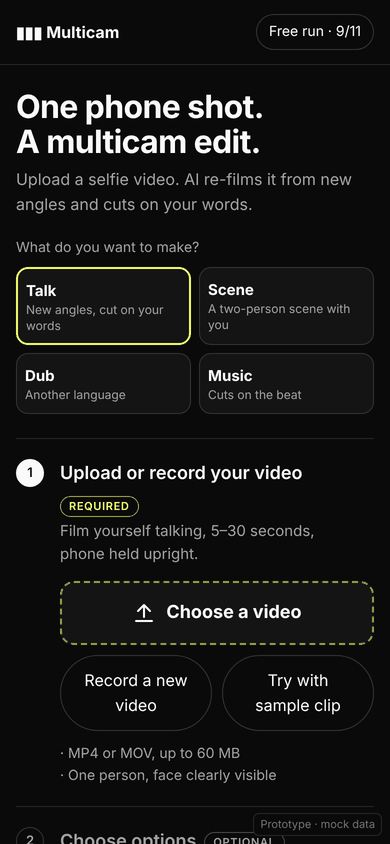
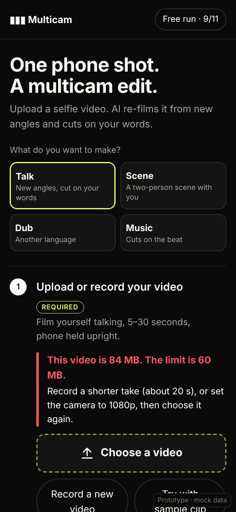
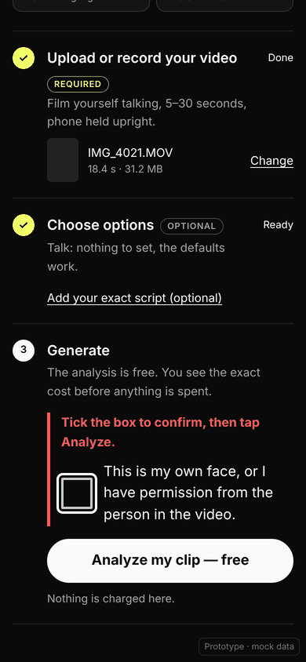
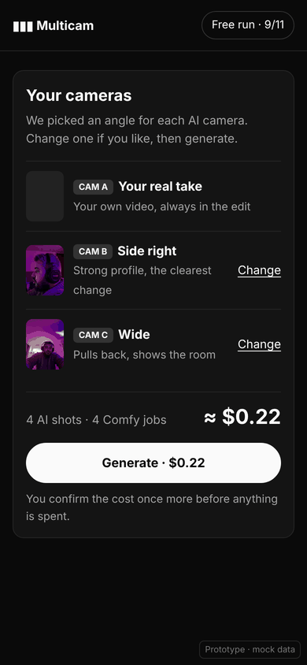
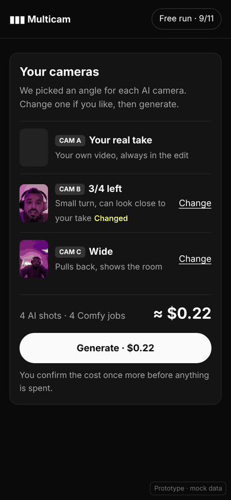

# Mobile steps prototype

This is a single-file, self-contained prototype of the phone flow, made on 2026-10-28. It covers the three
numbered steps, the too-big file error, consent v2 (an unticked tap on Analyze shows the error on the box), and
the "Your cameras" review with one-tap camera changes. It uses mock data only and makes no network calls. The
angle thumbnails are small inline copies of the demo angle stills. The markup mirrors the live app
(`ol.steps-flow > li.step[data-state]`), so the CSS can move across easily.

Open `index.html` in a browser at phone width. A hash picks the state, which is how the screenshots were made:
`#s=start`, `#s=toobig`, `#s=uploaded`, `#s=consenterr`, `#s=cams`, `#s=pick`, `#s=changed`.

| Start | Too big | Consent error | Cameras | Camera changed |
|---|---|---|---|---|
|  |  |  |  |  |

The live app already ships the too-big error, consent v2 and the accent check marks. The camera review screen is
still a proposal.
